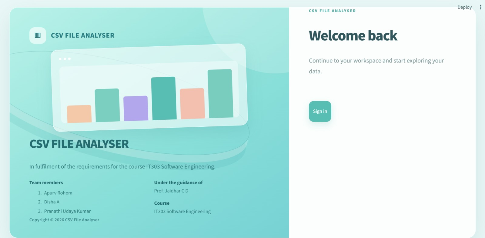
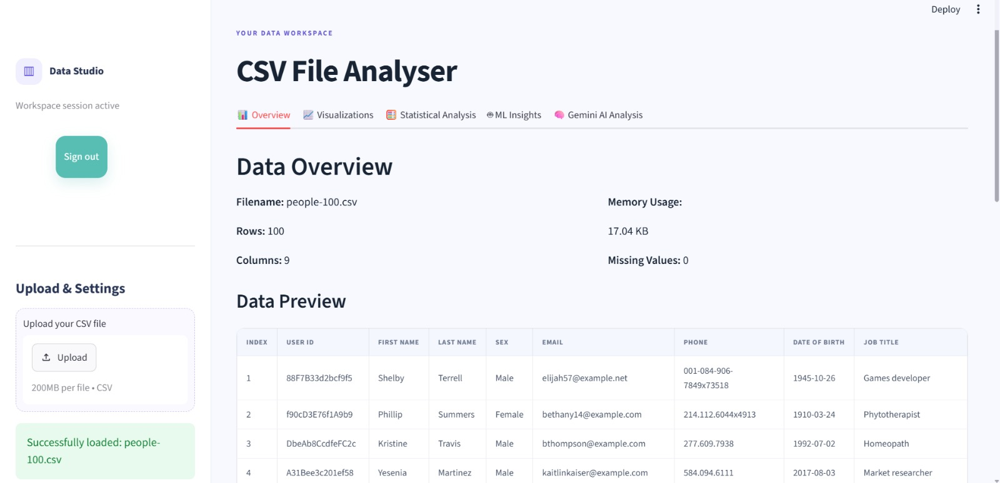

# CSV File Analyser

CSV File Analyser is a web application for exploring CSV data. A user signs in with Google, uploads a CSV, and uses the workspace to inspect data quality, create charts, calculate statistics, explore time-based data, and optionally request written insights from Google Gemini.

The application is built with Python and Streamlit. Its main entry point is `app.py`; reusable loading, analysis, visualization, and activity logging code lives under `modules/`.

**Live application:** [https://csv-file-analyser.onrender.com](https://csv-file-analyser.onrender.com)

**Current deployed branch:** `onedrive-release-20261011`

## Screenshots

### Google sign-in page

The app asks the user to sign in before opening the data workspace.



### Data overview

After sign-in and CSV upload, the Overview tab shows a preview and basic dataset information.



## What the application does

The app follows this flow:

```text
Browser → Google sign-in → Streamlit app → CSV loader → Analysis modules → Results
                                                       ├→ Activity history
                                                       └→ Gemini (optional)
```

1. The visitor signs in with Google.
2. The user uploads a `.csv` file in the sidebar.
3. The app reads the file into a Pandas DataFrame, which is a table of rows and columns.
4. The user chooses an analysis tab and selects columns or options.
5. The app displays tables, metrics, charts, or a generated report.
6. If Gemini is configured, the user can request additional written analysis.

The uploaded and transformed tables are kept in the user's Streamlit session while that session is active. The app keeps a copy of the original upload so the user can restore it after removing duplicate rows.

## Features

### Google sign-in and user history

- Google OAuth sign-in is required before analyzer functionality is shown.
- The sidebar shows the signed-in account and its previous recorded login time.
- Users can sign out and view their own activity history.
- An administrator email allowlist can be configured to let designated owners review all recorded activity.

### CSV upload and overview

- Upload CSV files through the Streamlit sidebar.
- View the filename, row and column counts, memory usage, and total missing values.
- Preview the first ten rows and inspect each column's type, number of unique values, and missing-value count/percentage.
- Download the current processed table as a CSV.

### EDA and data quality

EDA means **exploratory data analysis**: looking around a dataset to understand its shape and spot potential problems before drawing conclusions.

- Dataset profile: rows, columns, missing cells, duplicate rows, and counts of numeric, categorical, date/time, and boolean columns.
- Column profile: a closer look at a selected column.
- Quality score and a table of detected issues.
- Additional checks for missingness and duplicate rows.
- Automated EDA report and quick insights.
- Remove exact duplicate rows and restore the original uploaded data with **Reset to uploaded data**.

### Visualizations

The regular Visualizations tab can display:

- Numeric distributions using histograms and box plots.
- Correlations between numeric columns using a heatmap.
- Category counts using a categorical chart.
- Relationships between two numeric columns using a scatter plot.
- Group summaries as a chart.

The Advanced Visualizations tab includes options such as ECDF, Q-Q, violin, boxen, Pareto, missingness, hexbin, 2D density, parallel-coordinate, residual, and grouped plots. A chart may need certain column types or a minimum number of columns; the app explains when the uploaded table does not meet those requirements.

### Statistical analysis

- Descriptive statistics for numeric columns.
- Group-by summaries using mean, median, sum, minimum, maximum, count, or standard deviation.
- Missing-value summaries.
- Potential outlier summaries using the IQR or Z-score method.
- Advanced pairwise analysis, including correlation or contingency-table results depending on the selected columns.
- Pearson, Spearman, and Kendall correlation options.
- Benjamini–Hochberg adjustment for multiple p-value comparisons.

Statistical results describe patterns in the uploaded data. They do not by themselves prove that one variable caused another.

### Time-series analysis

Time-series tools work when the uploaded CSV has a usable date/time column and a numeric value column. Available views include:

- Trend line.
- Rolling statistics.
- Seasonal decomposition.
- ACF/PACF plots and lag plots.
- Percentage change.
- Resampled values with a chosen frequency and aggregation.
- A time-series profile with optional duplicate-timestamp handling and resampling.

### Gemini AI analysis

Gemini is optional. The user enters a Gemini API key in the sidebar and chooses one of these analysis types:

- Data Summary and Insights.
- Correlation Analysis.
- Trend Identification.
- Anomaly Detection.
- Custom Analysis.

The Gemini feature is intended to provide a natural-language interpretation and suggestions. Review its output against the actual data and statistical results; generated text can be incomplete or wrong.

## Project structure

```text
app.py                                  Streamlit page, login gate, sidebar, and tabs
modules/
  activity_log.py                      SQLite activity history
  input_module/data_loader.py          CSV upload and session data management
  data_analysis_module/
    statistical_analyzer.py            Standard statistics
    data_profiler.py                   Dataset and column profiles
    data_quality_analyzer.py           Missingness, duplicates, and quality checks
    advanced_statistical_analyzer.py   Advanced statistics
    automated_insights.py              Formatted EDA report
    advanced_eda.py                    Pairwise and helper analyses
    eda_workbench.py                   EDA profiles and quick insights
    time_series_analyzer.py            Time-series analysis and charts
  data_visualization_module/           Standard and advanced visualizations
  processing_module/gemini_analyzer.py Optional Gemini integration
.streamlit/
  secrets.toml.example                 Safe template for local OAuth configuration
requirements.txt                       Python dependencies
sample_data.csv                         Example CSV for a demo
```

The repository also contains older prototype assets. The active Streamlit application is launched from `app.py`; its current tabs are the ones listed above. **ML Insights is not part of the active app workflow.**

## Technology

| Technology | Role in the project |
| --- | --- |
| Python | Application and analysis logic |
| Streamlit | Web interface, interactive widgets, login, and session state |
| Pandas | Read and manipulate CSV tables |
| Matplotlib and Seaborn | Charts and plots |
| SciPy and Statsmodels | Statistical and time-series calculations |
| Google Gemini API | Optional natural-language analysis |
| SQLite | Local activity-event storage |

The current requirements file also includes scikit-learn for existing cleaning utilities. The current Streamlit interface does not expose a Machine Learning Insights tab.

## Run locally on Windows

Open PowerShell in the project folder.

1. Create and activate a virtual environment:

   ```powershell
   py -m venv .venv
   .\.venv\Scripts\Activate.ps1
   ```

2. Install the project dependencies:

   ```powershell
   python -m pip install --upgrade pip
   python -m pip install -r requirements.txt
   ```

3. Create a local secrets file from the example:

   ```powershell
   Copy-Item .streamlit\secrets.toml.example .streamlit\secrets.toml
   ```

4. Edit `.streamlit/secrets.toml` with your own Google OAuth credentials. Keep this private; `.gitignore` excludes it.

5. In Google Cloud's OAuth client, add this exact authorized redirect URI for local testing:

   ```text
   http://localhost:8501/oauth2callback
   ```

6. Start the app:

   ```powershell
   streamlit run app.py --server.port 8501
   ```

7. Open [http://localhost:8501](http://localhost:8501) and sign in with an account permitted by the OAuth consent-screen settings.

### Local secrets template

The example file contains placeholders only. Replace them locally; do not commit real values.

```toml
[auth]
redirect_uri = "http://localhost:8501/oauth2callback"
cookie_secret = "replace-with-a-long-random-secret"
client_id = "replace-with-your-google-oauth-client-id"
client_secret = "replace-with-your-google-oauth-client-secret"
server_metadata_url = "https://accounts.google.com/.well-known/openid-configuration"

[activity]
admin_emails = ["owner@example.com"]
```

The `[activity]` section is optional. Add only trusted owner addresses to `admin_emails`.

## Google OAuth setup

1. In Google Cloud Console, select the project and configure the Google Auth Platform consent screen.
2. For an External audience in testing mode, add the Google accounts that should be permitted to sign in.
3. Create a **Web application** OAuth client.
4. Add the exact callback URL for each environment as an **Authorized redirect URI**:
   - Local: `http://localhost:8501/oauth2callback`
   - Render: `https://csv-file-analyser.onrender.com/oauth2callback`
5. Put the matching client ID and client secret in the hosting environment's private secret store. The client ID and secret must come from the same OAuth client.
6. Never commit `secrets.toml`, client secrets, cookie secrets, or API keys.

The app uses Google's OpenID Connect discovery URL through Streamlit's authentication configuration. Google handles the password flow; this project does not create or store Google passwords.

## Deploy on Render

The current live Render service deploys from the `onedrive-release-20261011` branch. Its repository root is the project root, so **Root Directory** should be blank.

1. Connect the GitHub repository and select `onedrive-release-20261011` as the deploy branch.
2. Set **Build Command** to:

   ```bash
   pip install -r requirements.txt
   ```

3. Add a Render **Secret File** named exactly `secrets.toml` (no leading dot and no directory path). Put the full TOML contents in that file, including `[auth]` and the production redirect URI.
4. Set **Start Command** to:

   ```bash
   mkdir -p .streamlit && cp /etc/secrets/secrets.toml .streamlit/secrets.toml && exec streamlit run app.py --server.address 0.0.0.0 --server.port $PORT
   ```

   Render mounts the secret file at `/etc/secrets/secrets.toml`; the command copies it into Streamlit's expected `.streamlit/secrets.toml` location before starting the server.

5. In Google Cloud, make sure the OAuth client has this exact authorized redirect URI:

   ```text
   https://csv-file-analyser.onrender.com/oauth2callback
   ```

6. Save the service settings and wait for the deployment to succeed. Review Render's application logs if the service does not start.

## Gemini API setup

1. Create a Gemini API key in Google AI Studio.
2. Open the app and sign in.
3. Paste the key into **Gemini AI Integration** in the sidebar. Do not put it in source code, a public GitHub file, or a screenshot.
4. Upload a CSV, open **Gemini AI Analysis**, choose an analysis type, and click **Run AI Analysis**.

Gemini analysis requires internet access, an active API key, and a model available to that key. The current code uses the `google-generativeai` SDK; Render has emitted a deprecation warning for that SDK, so migration to Google's newer `google-genai` SDK is a future maintenance task.

## Activity history and storage

`modules/activity_log.py` stores small events in SQLite. The default path is `.streamlit/activity_log.sqlite3`; set the `CSV_ANALYSER_ACTIVITY_DB` environment variable to select another location.

Recorded events include sign-in start/success, sign-out, upload success/failure, tab opens, generated reports, duplicate removal/reset, Gemini actions, and downloads. Upload events store counts and file size rather than CSV rows. The logger is designed not to interrupt analysis if SQLite logging fails.

The SQLite file is excluded from Git. On a host with an ephemeral filesystem, local SQLite data may disappear when the service is replaced or restarted. Use persistent storage or an external database if audit history must survive deployments.

## Data handling and privacy

- The CSV is processed by the app during the user's Streamlit session. It is not added to the Git repository by the application.
- The activity log stores event metadata; it does not store row-level CSV data, Gemini prompts/results, OAuth credentials, or the Gemini API key.
- When a user explicitly runs Gemini analysis, the current code sends selected dataset information to Google's Gemini API. Depending on the selected analysis, this can include column information, the first five rows, descriptive statistics, or a numeric correlation matrix.
- Do not send confidential or personally identifying CSV contents to Gemini unless you have approval to share them with that service.
- OAuth and Gemini secrets belong in local ignored secrets files or the hosting provider's secret store, never in Git.

## Important limitations

- The uploader accepts CSV files; it is not a general Excel or database importer.
- Different tools require different column types. For example, time-series features need date/time and numeric data.
- Gemini output is generated text and should be checked before it is used to make decisions.
- The app's Google sign-in is OAuth-based; the current project does not provide its own email/password account database.
- The activity log uses SQLite. Durable production audit storage needs a persistent disk or database configuration.
- The active interface does not contain the old ML Insights tab, even though legacy ML-related files remain in the repository.

## Troubleshooting

### “Google sign-in is not configured yet”

Check that the app can read a valid `secrets.toml` containing an `[auth]` section. On Render, check the secret-file name and the Start Command that copies it into `.streamlit/`.

### Google says `invalid_client` or the OAuth client was deleted

Use an active OAuth client. Confirm that the client ID and client secret belong together, and that the redirect URI in Google Cloud exactly matches the app URL and `/oauth2callback` path.

### Gemini reports a model or API-key error

Check that the key is active and permitted to use the Gemini API. Confirm that the model configured in the current app is available to that key. The OAuth client secret and Gemini API key are separate credentials.

### The app takes a long time to open

Render's free instance may sleep while idle, so its first request can take longer. Check the Render service status and application logs if it does not recover.

## Presentation/demo checklist

1. Sign in with Google.
2. Upload `sample_data.csv` or another non-sensitive CSV.
3. Show the Overview metrics and data preview.
4. Show a quality check and a chart.
5. Show one statistical or time-series analysis that matches the sample data.
6. Optionally run Gemini analysis with a non-sensitive dataset.
7. Point out last login and the activity-history panel.

**Short project description:** CSV File Analyser is a Streamlit application that lets authenticated users upload CSV files and explore them with data-quality checks, visualizations, statistics, time-series tools, and optional Gemini-generated explanations.
